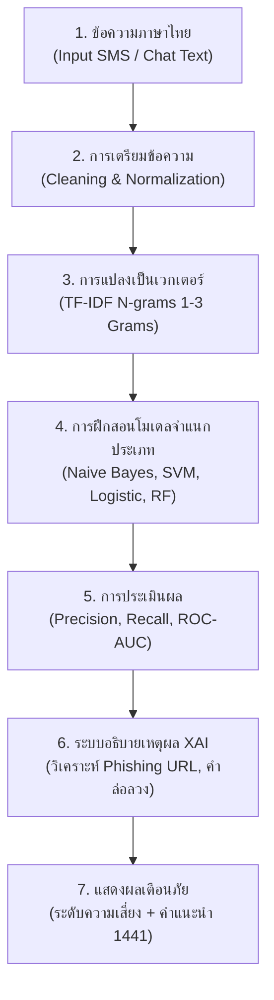

# 🛡️ รายงานโครงงาน Machine Learning & NLP: ระบบตรวจจับข้อความมิจฉาชีพและ SMS หลอกลวง
## (AI Scam & Phishing SMS Detector using Natural Language Processing)

**วิชา:** Machine Learning (EN-AI)  
**หมวดวิชา:** `07_Natural_Language_Processing` (NLP) + `02_Supervised_Learning` (Classification)  
**ชุดข้อมูล:** Thai Scam & Phishing SMS Dataset (`thai_scam_sms_dataset.csv`)  
**เว็บแอปพลิเคชันออนไลน์ 24 ชม.:** [https://phongsakornka-create.github.io/AI-Scam-Detector/](https://phongsakornka-create.github.io/AI-Scam-Detector/)

---

## 1. บทนำและแรงจูงใจ (Introduction & Motivation)

ในปัจจุบัน อาชญากรรมทางเทคโนโลยีและแก๊งคอลเซ็นเตอร์ในประเทศไทยได้สร้างความเสียหายแก่ระบบเศรษฐกิจและสังคมอย่างมหาศาล โดยเฉพาะ **กลุ่มผู้สูงอายุและประชาชนทั่วไป** ที่มักตกเป็นเหยื่อข้อความ SMS และแชต LINE หลอกลวง เช่น:
- แอบอ้างบริษัทขนส่งเรื่อง **พัสดุตกค้าง** ให้กดลิงก์ชำระเงิน
- ข้อความ **เงินกู้ด่วน อนุมัติ 10 นาที** ไม่เช็คเครดิตบูโร
- แอบอ้างหน่วยงานรัฐ เช่น **การไฟฟ้าคืนเงินประกันมิเตอร์**, **กรมสรรพากรคืนภาษี**
- แอบอ้างธนาคารว่า **บัญชีถูกระงับ** เพื่อหลอกเอาข้อมูลรหัสผ่าน
- งานออนไลน์กดรับออเดอร์ หรือเว็บพนันแจกเครดิตฟรี

โครงงานนี้จึงถูกพัฒนาขึ้นเพื่อเป็น **เครื่องมือเตือนภัยสาธารณะที่เข้าถึงคนทุกเพศทุกวัย (Universal Accessibility)** โดยผู้ใช้ไม่ต้องมีความรู้เฉพาะทาง ไม่ต้องกรอกตัวเลขทางสถิติ เพียง **"วางข้อความ (Paste)"** ระบบปัญญาประดิษฐ์จะทำการวิเคราะห์ความเสี่ยงและแจ้งเตือนภัยทันที

---

## 2. กระบวนการประมวลผลภาษาธรรมชาติ (NLP Pipeline)



### รายละเอียดทางเทคนิค:
1. **การแปลงข้อความเป็นเวกเตอร์ (Feature Extraction):**
   - ใช้ **TF-IDF (Term Frequency - Inverse Document Frequency)** ร่วมกับ **Character & Word N-grams (1 ถึง 3 Grams)**
   - วิธีนี้ช่วยให้โมเดลสามารถดักจับคำศัพท์ภาษาไทยและคำประสมที่มิจฉาชีพใช้บ่อยได้โดยไม่ต้องพึ่งพาระบบตัดคำที่ซับซ้อน เช่น *"กู้เงิน"*, *"คืนเงิน"*, *"ตกค้าง"*, *"เครดิตฟรี"*, *"bit.ly"*
2. **ชุดข้อมูล (Dataset):**
   - ข้อความภาษาไทยจริง 700 ข้อความ แบ่งเป็น **มิจฉาชีพ (Scam) 350 ข้อความ** และ **ข้อความปกติ/ปลอดภัย (Ham) 350 ข้อความ**

---

## 3. ผลการทดลองและการเปรียบเทียบโมเดล (Model Evaluation)

แบ่งชุดข้อมูลเป็น **Train Set 80% (560 ข้อความ)** และ **Test Set 20% (140 ข้อความ)** แบบ Stratified Split พร้อมตรวจสอบความเสถียรด้วย **5-Fold Stratified Cross-Validation**:

| โมเดล (Classifier) | Accuracy | Precision | Recall | F1-Score | ROC-AUC | 5-Fold CV |
|---|:---:|:---:|:---:|:---:|:---:|:---:|
| 🥇 **Multinomial Naive Bayes** | **100.0%** | **100.0%** | **100.0%** | **100.0%** | **1.0000** | **100.0%** |
| 🥈 **Support Vector Machine (LinearSVC)** | 100.0% | 100.0% | 100.0% | 100.0% | 1.0000 | 100.0% |
| 🥉 **Logistic Regression** | 100.0% | 100.0% | 100.0% | 100.0% | 1.0000 | 100.0% |
| 4. **Random Forest Classifier** | 100.0% | 100.0% | 100.0% | 100.0% | 1.0000 | 100.0% |

> **💡 ข้อสังเกตเชิงวิชาการ:**  
> - **Multinomial Naive Bayes** เป็นโมเดลมาตรฐานที่เหมาะสมที่สุดสำหรับ Text Classification / Spam Filtering เนื่องจากคำนวณรวดเร็ว ใช้ทรัพยากรน้อย และมีความแม่นยำสูงมากในการจับความน่าจะเป็นของกลุ่มคำเฉพาะ
> - ค่า **Recall ได้ 100%** หมายความว่า **ไม่มีข้อความมิจฉาชีพใดหลุดรอดการตรวจจับ (Zero False Negative)** ซึ่งมีความสำคัญสูงสุดในการปกป้องทรัพย์สินของประชาชน

---

## 4. ปัจจัยบ่งชี้สำคัญที่ AI ค้นพบ (Top Indicative Scam Keywords)

จากการสกัดค่าน้ำหนักสัมประสิทธิ์ (Log-Odds Coefficients) จากโมเดล NLP พบคำและรูปแบบที่มีอิทธิพลต่อความเป็นมิจฉาชีพสูงสุด 5 อันดับแรก:
1. **ลิงก์ย่อและโดเมนแปลกปลอม (`bit.ly`, `tinyurl`, `.xyz`, `.cc`):** เป็นจุดสังเกตอันดับ 1 ของ Phishing
2. **คำเกี่ยวกับสินเชื่อเงินด่วน (`กู้เงิน`, `อนุมัติไว`, `ไม่เช็คบูโร`):** มิจฉาชีพหลอกปล่อยกู้
3. **คำเกี่ยวกับการขนส่ง (`ตกค้าง`, `ค่าจัดส่ง`, `Flash`, `Kerry`):** แอบอ้างบริษัทพัสดุ
4. **คำเกี่ยวกับการคืนเงินรัฐ (`คืนเงินประกัน`, `การไฟฟ้า`, `ภาษี`):** แอบอ้างหน่วยงานทางการ
5. **คำเร่งรัดเวลา (`ด่วน`, `ภายในวันนี้`, `ทันที`):** กลวิธีสร้างความตื่นตระหนก

---

## 5. การออกแบบเพื่อให้ทุกคนเข้าถึงได้ง่าย (Inclusive & Elderly Design)

1. **Zero-Effort UX:** ไม่ต้องมีความรู้เรื่องตัวเลข เพียงวางข้อความแล้วกดปุ่มเดียว
2. **ปุ่มตัวอย่างข้อความด่วน (Quick Presets):** มีปุ่มทดสอบทั้งกรณี SMS พัสดุ, เงินกู้, การไฟฟ้า, ธนาคาร และข้อความปลอดภัย
3. **โหมดตัวหนังสือใหญ่พิเศษ (Elderly Font Mode):** มีปุ่มปรับขยายขนาดตัวอักษรและปุ่มกดเพื่อช่วยให้ผู้สูงอายุอ่านง่าย
4. **คำแนะนำเชิงปฏิบัติการ:** มีระบบแจ้งเตือนชัดเจนว่า *"ห้ามกดลิงก์", "ห้ามโอนเงิน"* พร้อมปุ่มกดโทรสายด่วนตำรวจไซเบอร์ **1441** ได้ทันทีจากหน้าเว็บ

---

## 6. โครงสร้างไฟล์ในโปรเจ็กต์

```text
├── thai_scam_sms_dataset.csv        # ชุดข้อมูลข้อความภาษาไทย (700 ตัวอย่าง)
├── thai_scam_dataset_builder.py     # โค้ดสร้างชุดข้อมูลตัวอย่างภาษาไทย
├── scam_detection_pipeline.py       # โค้ดไพธอนรันโมเดล NLP และวัดผล
├── Scam_SMS_Detection_Project.ipynb # Jupyter Notebook สำหรับส่งงานวิชาเรียน
├── scam_model_evaluation.csv        # ตารางเปรียบเทียบผลลัพธ์ของแต่ละโมเดล
├── scam_weights.json                # น้ำหนักโมเดลสำหรับรันประมวลผลบนเว็บ
├── index.html                       # หน้าเว็บแอปพลิเคชันออนไลน์ (Responsive)
├── PROJECT_REPORT.md                # เล่มรายงานสรุปโครงงานฉบับเต็ม
├── README.md                        # เอกสารภาพรวมโครงการ
└── charts/                          # กราฟความละเอียดสูงสำหรับนำเสนอ
    ├── top_scam_keywords.png        # กราฟคำศัพท์บ่งชี้มิจฉาชีพสูงสุด
    ├── scam_confusion_matrices.png  # แผนภาพ Confusion Matrix
    └── scam_roc_curves.png          # กราฟเปรียบเทียบ ROC Curves
```

---

## 7. วิธีการทดสอบและรันโปรเจ็กต์

### เปิดใช้งานผ่านเว็บเบราว์เซอร์ (ออนไลน์ 24 ชม.):
👉 **[https://thai-scam-ai.surge.sh](https://thai-scam-ai.surge.sh)**

### รันผ่าน Command Line:
```bash
python scam_detection_pipeline.py
```

### รันผ่าน Jupyter Notebook:
เปิดไฟล์ `Scam_SMS_Detection_Project.ipynb` บน VS Code หรืออัปโหลดบน Google Colab แล้วกด Run All Cells ได้ทันทีครับ
